# FreeVideo 项目方案

> 版本：v1（方案评审稿） · 日期：2026-10-15 · 作者：陛下 & Agent
> 状态：**待陛下评审拍板**（见 §17 待决问题），通过后进入 M1 开发。

---

## 1. 一句话定位

**FreeVideo = 一个"免费/低价 API 额度聚合路由器"**：把散落在几十个平台的免费生成额度（视频、图片、音频）汇成一个池子，用统一的应用层抽象屏蔽平台差异，按"能力匹配 + 质量优先 + 剩余额度"自动路由，一个源耗尽自动换下一个，前端无感。

---

## 2. 需求逐条映射（陛下的 8 点 → 设计决策）

| # | 陛下原需求 | 设计方案 | 落在哪一节 |
|---|---|---|---|
| 1 | 每个平台注册一遍，每天拥有足够大的免费 token 池 | **Key 池**：`provider × key` 一对多，池化额度 = Σ各 key 剩余量 | §6 数据模型 |
| 2 | 应用层抽象兼容，平滑切换，用户无感 | **适配器协议**（统一 NormalizedRequest/Response）+ **路由引擎**透明选源 + 失败自动 fallback | §7 §8 |
| 3 | 设置页填 key，一平台可多 key，key 不重复 | Key CRUD；`unique(provider_id, key_hash)` 约束；每个 key 独立额度账本 | §6 §10 |
| 4 | 前端公共参数（提示词/首尾帧/比例/时长/质量），选中参数后反选可用 api | **NormalizedRequest 公共参数 schema** + **能力清单 manifest** + 前端实时可用性反查 | §7 §11 |
| 5 | 优先耗费质量好的 api，渣的留最后 | 路由策略 `quality_first`（默认）：评分 = 质量分主导，同分比剩余量 | §8 |
| 6 | 按 token 剩余量选择可用模型 | `remaining_ratio` 进评分；耗尽自动剔除；按日/月重置调度 | §8 §9 |
| 7 | 用户可配置采购来的（付费）api，自填服务参数 | **通用 HTTP Provider 模板**（声明式 JSON）+ 内置适配器双轨 | §13 |
| 8 | 同时支持生成音频、图片，与视频并列 | 三模态统一架构：`modality` 作为一等维度，适配器按模态分组，复用同一套 Key 池/队列/路由 | §5 §12 |

---

## 3. 关键调研结论（2026-10-15，附重大修正）

### 3.1 ⚠️ 重大修正：陛下的"免费 token 池"设想，对三种模态的可行度完全不同

调研后发现一个必须先说清楚的事实，它直接决定项目路线：

| 模态 | 免费额度的真实分布 | 池化可行性 |
|---|---|---|
| **图片** | 多家有**真 API 免费额度**（Cloudflare 每天约 200 张、ModelScope 约 250 张/天、OpenRouter 50 张/天……） | ✅ 完全成立，纯 API 即可组池 |
| **音频** | TTS 免费 API 额度极大（Azure 50 万字符/月、Google 约 100 万字符/月、腾讯云 100 万字符/月……）；音乐 API 也有（Stable Audio、ElevenLabs Music、Mubert） | ✅ 基本成立 |
| **视频** | **国内平台（即梦/可灵/元宝/清影/绘想）的免费额度几乎都在 Web/App 端，公开 API 一律付费**；真免费的只有 ModelScope 每日 API（Wan2.2）和本地开源模型 | ⚠️ 部分成立，需要组合路线 |

**视频的三条路线（需陛下拍板，见 §17-Q1）：**
- **路线 A（稳）**：只做 API-native。免费部分靠 ModelScope 每日 API + 各云厂商新用户试用额度；主力是低价订阅（Vidu ¥48/月、Kling $7.99/月）。合规、稳定、可维护。
- **路线 B（免费最大化）**：A + **Web 逆向适配器**（抓即梦/可灵/元宝等网页端接口）。免费额度最大化，但违反平台 ToS、接口易失效、需隔离为可随时禁用的独立适配层。
- **路线 C（零成本终点）**：A + **本地开源模型**（Wan2.2 / FLUX.1-schnell，Apache 2.0 可商用）。有 GPU 则真免费，无 GPU 则跳过。
- 建议：**v1 走 A + 预留 B/C 的适配器插槽**，B/C 作为后期扩展模块（架构上必须能一键禁用）。

### 3.2 视频服务商矩阵

| 平台 | 免费额度 | API | 单条成本参考 | 能力要点 | v1 优先级 |
|---|---|---|---|---|---|
| ModelScope 魔搭（Wan2.2） | **每日免费 API** | ✅ | ¥0 | 文生/图生视频，720P | ⭐ 首批 |
| Vidu | $10/月 800 积分（≈200 条 4s） | ✅ | ¥1.5~3（批量低至 ¥0.04） | 多主体一致性，4K 放大 | ⭐ 首批 |
| Kling 可灵国际版 | $7.99/月 660 积分 | ✅ | ≈¥0.5~1.5 | 物理细节强，最长 10s | ⭐ 首批 |
| Luma Dream Machine | 低价订阅 | ✅ | ≈¥0.6/条 | 电影感运镜，生成快 | 第二批 |
| MiniMax 海螺 | 少量体验额度 | ✅ | $2.8/分钟 | 微表情/数字人 | 第二批 |
| Pika | $8/月 | ✅ | ≈¥2.3/条 | 创意特效 | 第二批 |
| 火山引擎 Seedance | 新用户试用 | ✅ | 按量 | 30s 长视频，剪映生态 | 按量池 |
| 阿里百炼 万相 | 新用户试用 | ✅ | ≈¥0.6/秒 | 长视频，开源同源 | 按量池 |
| 即梦 / 可灵国内 / 元宝 / 清影 / 绘想 / 通义 App | Web 端免费（每日积分~不限量） | ❌（API 付费） | — | 免费额度的大头 | **Web 逆向（v2）** |
| 本地 Wan2.2 | 无限（有 GPU） | 自部署 | 电费 | Apache 2.0 可商用 | v2 可选 |

> 注：**Sora 已于 2026-03 被 OpenAI 关停**（全系 App/API/ChatGPT 内视频功能），任何"Sora 平替"服务不要碰。Bing Video Creator 限中国大陆以外，模型来源存疑，不建议纳入。

### 3.3 音频服务商矩阵

**TTS（文本→语音）：**

| 平台 | 免费额度 | API | 备注 |
|---|---|---|---|
| Edge-TTS | 无限，无需 key | 逆向（灰） | 200+  neural 音色，陛下 claw-phonecall 项目已在用；ToS 风险。**实现决策（2026-10-15 定稿）**：不手搓 WebSocket 协议，改为把官方开源库 edge-tts 的 CLI 当 sidecar 子进程调（等同调用 openai npm 包，非逆向）；缺 Python 依赖时该源自动降级停用，设置页点"测试"后自愈。详见 §20 |
| Microsoft Azure TTS | 50 万字符/月（永久） | ✅ | Neural 音质好，SSML 强，需绑卡 |
| Google Cloud TTS | 约 100 万字符/月（永久） | ✅ | 需绑卡 |
| 腾讯云语音合成 | 基础音色约 100 万字符/月 | ✅ | 国内直连，中文自然度好 |
| ElevenLabs | 1 万字符/月 | ✅ | 英文质量天花板，无需绑卡 |
| Cartesia Sonic | 2 万字符/月 | ✅ | 40ms 延迟，无需绑卡 |
| 火山引擎 TTS | 新用户约 2 万字符 | ✅ | 短视频音色 |
| TTSMaker | 3 万字符/周 | ✅ | 50+ 语种 |
| 开源 Kokoro / Qwen3-TTS / CosyVoice | 无限（自部署） | 本地 | Kokoro CPU 可跑；CosyVoice Apache 2.0 可商用 |

**音乐（文本→歌曲/BGM）：**

| 平台 | 免费额度 | API | 备注 |
|---|---|---|---|
| Stable Audio | 约 20~50 首/月（非商用） | ✅ | 开源权重可商用（<$1M 营收），纯器乐/SFX |
| ElevenLabs Music | 1 万 credits/月（≈11 分钟） | ✅ | 含在 ElevenLabs 免费档内 |
| Mubert | 25 次生成/月 | ✅ | 水印+署名，非商用 |
| Google Lyria 3 | 30 秒片段（Gemini 账号） | ✅ | 18+ |
| Suno / Udio | 50 / 10 credits 每天 | ❌ 无公开 API | 免费大头在 Web 端，v2 逆向对象 |

### 3.4 图片服务商矩阵

| 平台 | 免费额度 | API | 备注 |
|---|---|---|---|
| Cloudflare Workers AI | **每天约 173~230 张**（FLUX.1-schnell，10k neurons/天） | ✅ | 无需绑卡，UTC 0 点重置，**最佳 recurring 免费源** |
| ModelScope API-Inference | 约 250 次/天（Qwen-Image-2.1） | ✅ | 需实名阿里云账号，非商用 |
| OpenRouter | 50 次/天 | ✅ | OpenAI 兼容格式，国内可直连 |
| 硅基流动 SiliconFlow | 新用户赠额度（约 2000 万 Token） | ✅ | 开源模型聚合，OpenAI 兼容 |
| 智谱 AI | 新用户约 2000 万 Token | ✅ | CogView 系列 |
| 通义万相 | 新用户约 1000 次 | ✅ | 中文生图首选 |
| Together AI | FLUX.1-schnell 免费 endpoint + $1 | ✅ | 一 key 两用 |
| Google Gemini（Nano Banana） | 小额免费额度（收紧中） | ✅ | 指令遵循最强 |
| Pollinations.ai | ⚠️ 2026-10 起**取消匿名免费**，需 key + 预存 | ✅ | 老牌免费源已变天 |
| 本地 FLUX.1-schnell | 无限（有 GPU） | 本地 | Apache 2.0 可商用 |

---

## 4. 总体架构

```mermaid
flowchart TB
    subgraph FE["前端（Next.js）"]
        G["统一生成工具<br/>视频 / 图片 / 音频 · 公共参数表单 · 实时可用源反查"]
        S["设置中心<br/>Key 管理 · Provider 目录 · 自定义模板"]
        T["任务中心<br/>进度 · 换源重试 · 下载"]
        D["统计看板<br/>额度消耗 · 成功率 · 成本核算"]
    end

    subgraph CORE["FreeVideo 核心服务"]
        API["API 层<br/>REST + 参数校验"]
        Q["任务队列<br/>SQLite 持久化 · 并发控制 · 退避重试"]
        R["路由引擎<br/>能力过滤 → 评分 → 选源 → fallback"]
        K["Key 池管理器<br/>AES-256-GCM 加密 · 额度账本 · 健康度"]
        A["Provider 适配器层<br/>视频 / 图片 / 音频 · 统一协议"]
    end

    subgraph UP["上游"]
        U1["API 原生平台<br/>ModelScope · Vidu · Kling · Luma<br/>Azure · Google · Cloudflare · ElevenLabs…"]
        U2["Web 逆向适配（v2 可选）<br/>即梦 · 可灵 · 元宝 · Suno…"]
        U3["本地开源模型（v2 可选）<br/>Wan2.2 · FLUX · CosyVoice"]
    end

    DB[("SQLite<br/>keys / quota_ledger / tasks / media")]
    ST[("媒体存储<br/>本地磁盘 → 可插拔 S3/COS")]

    G --> API --> Q --> R --> K --> A --> U1
    A -.-> U2
    A -.-> U3
    K --> DB
    Q --> DB
    A --> ST
    U1 -- "429 / 耗尽 / 失败反馈" --> R
    T -.-> Q
    D -.-> DB
```



**数据流一句话**：用户在统一工具页填公共参数 → 服务端按能力清单过滤出可用 key 候选集 → 评分选源（质量优先、比剩余量）→ 入队执行 → 适配器调用上游 → 成功则扣额度、落库、存媒体；失败则按错误分类自动换下一个候选重试。

---

## 5. 模块划分与职责

| 模块 | 职责 |
|---|---|
| `providers/` | Provider 注册中心：内置适配器 + manifest（能力清单）+ 自定义 HTTP 模板 |
| `router/` | 路由引擎：候选过滤、评分、选源策略（可配置）、fallback 决策 |
| `pool/` | Key 池：加解密、额度账本、日/月重置调度、健康度（成功率/延迟）、冷却 |
| `queue/` | 任务队列：DB 持久化、worker 并发、per-key 信号量、轮询适配器、退避 |
| `adapters/video,image,audio/` | 按模态分组的适配器，实现统一协议 |
| `media/` | 媒体存储抽象（本地 → S3/COS）、缩略图、公网 URL 供给（给只接受 URL 的上游） |
| `web/` | 前端四页：统一工具 / 设置 / 任务中心 / 统计 |

---

## 6. 数据模型（SQLite / Prisma）

```prisma
model Provider {
  id          String   @id
  slug        String   @unique          // 如 "kling"、"vidu"、"modelscope-wan"
  name        String
  kind        String                    // builtin | custom_http | webhook | local
  modalities  String                    // JSON: ["video","image","audio"]
  manifest    String                    // JSON: 能力清单（见 §7.2）
  quality     Float     @default(0)     // 质量分 0~100（人工/榜单校准，用户可覆盖）
  enabled     Boolean   @default(true)
  keys        ApiKey[]
}

model ApiKey {
  id           String   @id
  providerId   String
  provider     Provider @relation(fields: [providerId], references: [id])
  label        String                   // 用户备注，如 "Vidu 号2"
  keyEnc       String                   // AES-256-GCM 密文
  keyHash      String                   // 唯一约束用（HMAC）
  priority     Int      @default(0)     // 用户手动加权（付费 key 可调高）
  status       String   @default("active") // active | exhausted | invalid | disabled
  quotaTotal   Float?                    // 本期总额度（积分/次数/字符）
  quotaUsed    Float    @default(0)
  resetRule    String   @default("none") // none | daily | monthly
  resetAt      DateTime?                // 下次重置时间
  cooldownTill DateTime?                // 限流冷却截止
  stats        String?                  // JSON: 成功率、平均耗时、连续失败数
  createdAt    DateTime @default(now())
  @@unique([providerId, keyHash])       // 需求3：同平台 key 不重复
}

model Task {
  id           String   @id
  modality     String                   // video | image | audio
  status       String                   // queued | running | succeeded | failed | canceled
  request      String                   // JSON: NormalizedRequest（可复现）
  providerId   String?
  apiKeyId     String?
  attempts     Int      @default(0)
  errorCode    String?                  // auth_invalid | quota_exceeded | rate_limited | content_blocked | transient
  errorMsg     String?
  mediaIds     String?                  // JSON: 产物 media id 列表
  costEstimate Float?                   // 付费 key 的成本估算（元）
  queuedAt     DateTime @default(now())
  startedAt    DateTime?
  finishedAt   DateTime?
}

model Media {
  id         String   @id
  taskId     String
  kind       String                     // video | image | audio
  uri        String                     // 本地路径或 s3://
  mime       String
  width      Int?
  height     Int?
  durationMs Int?
  sizeBytes  Int?
  watermark  Boolean  @default(false)   // 免费档多带水印，需向前端明示
  createdAt  DateTime @default(now())
}

model QuotaEvent {
  id        String   @id
  apiKeyId  String
  delta     Float                       // 消耗记负，重置记正
  reason    String                      // consume | reset | manual | upstream_report
  taskId    String?
  createdAt DateTime @default(now())
}

model Setting {
  key   String @id                     // routing.strategy / routing.weights / master.salt ...
  value String
}
```

---

## 7. Provider 抽象层

### 7.1 适配器协议（TypeScript）

```ts
// 统一请求：前端只认这一套，provider 差异全部关在适配器里
interface NormalizedRequest {
  modality: 'video' | 'image' | 'audio';
  prompt: string;
  negative_prompt?: string;
  first_frame?: MediaRef;      // 首帧图
  last_frame?: MediaRef;       // 尾帧图
  ref_images?: MediaRef[];     // 参考图（多主体一致性场景）
  ratio: '9:16' | '16:9' | '1:1' | '4:3' | '3:4' | '21:9';
  duration_s?: number;         // 视频/音频时长
  resolution?: '480p' | '720p' | '1080p' | '2k' | '4k';
  quality_tier?: 'draft' | 'standard' | 'high';
  fps?: number;
  seed?: number;
  count?: number;              // 一次出几条
  audio?: { enabled: boolean; voice?: string; bgm?: boolean };
  extras?: Record<string, unknown>;  // provider 私有参数透传
}

interface VideoAdapter {
  slug: string;
  capabilities(): Capability;            // 静态能力声明
  submit(req: NormalizedRequest, key: ResolvedKey): Promise<UpstreamJob>;
  poll(job: UpstreamJob, key: ResolvedKey): Promise<UpstreamStatus>; // running|succeeded|failed
  classifyError(err: unknown): ErrorClass; // 供路由引擎决策
}
```

### 7.2 能力清单 manifest（驱动需求 4 的"参数反选"）

每个 provider 声明一份 JSON，路由引擎和前端都消费它：

```json
{
  "slug": "vidu-q3",
  "modality": ["video"],
  "durations": [4, 8, 16],
  "ratios": ["9:16", "16:9", "1:1"],
  "resolutions": ["720p", "1080p", "4k"],
  "first_frame": true,
  "last_frame": true,
  "ref_images": { "max": 7 },
  "native_audio": true,
  "watermark_on_free": true,
  "commercial_ok": true,
  "avg_latency_ms": 90000,
  "quality": 88
}
```

前端效果：用户勾选"30 秒 + 尾帧 + 1080p" → 实时提示"当前参数可由 5 个 Key 服务：Vidu×2、Kling×2、ModelScope×1"，且不可用的源不参与路由（需求 4 的精确实现）。

### 7.3 公共参数 × 各平台支持度（抽象依据）

| 公共参数 | 视频 | 图片 | 音频(TTS) | 说明 |
|---|---|---|---|---|
| prompt | ✅ | ✅ | ✅(text) | 全部支持 |
| negative_prompt | 部分 | 部分 | — | 无则不传 |
| first/last_frame | ✅ 多数 | i2i 参考图 | — | 上游只收 URL 时走媒体服务换公网链接 |
| ratio | ✅ | ✅ | — | 映射到各家的 aspect_ratio |
| duration_s | ✅ | — | ✅ | 单位统一秒 |
| resolution | ✅ | ✅ | — | bitrate/samplerate 类比映射 |
| seed | 多数 | 多数 | — | 可复现 |
| count | 部分 | ✅ | — | 一次 N 条 |
| native_audio | 部分 | — | ✅ | 视频原生音频开关 |

---

## 8. 路由引擎（算法核心）

```
输入：NormalizedRequest + 策略配置
1. 候选过滤 candidates =
     provider.modality ∋ req.modality
     AND capabilitySatisfies(manifest, req)     // 需求4：参数反选
     AND key.status == 'active' AND key.remaining > 0   // 需求6
     AND key.cooldownTill < now
2. 评分 score(key) =
     0.50 × quality          // 需求5：质量好的优先耗
   + 0.30 × remaining_ratio  // 需求6：同质量比剩余量，先用将尽的
   + 0.10 × health           // 近期成功率/延迟（动态学习）
   + 0.10 × user_priority    // 付费 key 可手动加权
3. 选源 strategy（Setting 可配置，默认 quality_first）：
   - quality_first：取最高分；前 3 名内随机（避免单 key 瞬时打满）
   - round_robin：池内轮询，延长整体可用时间
   - least_used：优先用剩余比例最小的（先把快过期的用了）
4. 执行与 fallback：
   成功 → 扣减额度（QuotaEvent 记账）、记录 task/media
   失败 → classifyError 分流：
     auth_invalid    → key.status=invalid + 前端告警（key 失效，需更换）
     quota_exceeded  → remaining=0 + cooldown 至 resetAt + 换下一个候选
     rate_limited    → cooldown 5~60min（指数退避）+ 换候选
     content_blocked → 直接换候选（不标记 key 有问题）
     transient       → 同 key 重试 1 次，再换候选
   单任务最多尝试 N=3 个候选（可配置），全部失败才报错给用户
```

**设计取舍说明**：陛下要求"优先耗费质量好的、渣的留最后"（quality_first）与"按剩余量选"存在张力——极端质量优先会让高分 key 最先耗尽。解法是把两者都放进评分（质量主导、剩余量次之），并提供三种策略开关，默认 quality_first，池子大了之后可切 round_robin 延长整体续航。

---

## 9. 任务队列与并发

- **持久化队列**：jobs 存 SQLite，服务重启不丢任务；v1 用 DB 轮询 worker（不引 Redis，单人部署省心），量大了再换 BullMQ。
- **并发控制**：全局并发默认 2；每个 key 独立信号量（默认 1），遵守上游 RPM/并发限制。
- **异步适配**：视频上游普遍是 submit→poll 模式，适配器内部轮询（间隔 5~15s，按平台调），超时默认 10 分钟。
- **重置调度**：cron 每分钟扫描 `resetAt`，到点按 resetRule（daily 按 UTC+8 / monthly 按自然月 / none）重置 quotaUsed 并写 QuotaEvent。
- **背压**：池子全空时任务排队并提示"预计 X 分钟后有额度释放"，而不是直接失败。

---

## 10. Key 管理与安全

- **加密**：AES-256-GCM；主密钥来自环境变量 `FREEVIDEO_MASTER_KEY`，或首次运行时由用户设置的主密码 PBKDF2 派生（`Setting.master.salt`）。
- **展示**：UI 只显示后 4 位；日志永不打印完整 key。
- **去重**：`@@unique([providerId, keyHash])`，写入时查重并提示（需求 3）。
- **测试连接**：每个 key 一个"测试"按钮，跑一次最小请求验证可用性。
- **导入导出**：加密备份 JSON，换机器不丢 key。
- **gitignore**：`data/`、`.env` 强制忽略，防泄密。

---

## 11. 前端设计（4 页）

1. **统一生成工具 `/generate`**
   - 顶部模态 Tab：视频 / 图片 / 音频（需求 8）
   - 视频表单：提示词（支持负向）、首帧图、尾帧图、参考图、比例、时长、质量档位、数量、种子、原生音频开关
   - **实时可用源提示**：参数变动即反查"当前可由 N 个 Key 服务，最高质量源：XXX"（需求 4 的核心体验）
   - 提交后任务卡片内联展示进度
2. **任务中心 `/tasks`**：列表 + 详情；展示所用 provider/key 标签、失败原因、"换源重试"按钮、产物预览与下载；水印标识。
3. **设置中心 `/settings`**：
   - Key 管理：provider 卡片 → 多 key 增删（label/备注/优先级/状态），测试连接，剩余额度进度条
   - Provider 目录：内置适配器开关 + 质量分覆盖；自定义 HTTP 模板编辑（需求 7）
   - 路由策略：三种策略切换 + 权重微调 + 最大尝试次数
4. **统计看板 `/stats`**：每日生成量、各 key 消耗/剩余、成功率、平均耗时、付费 key 成本核算（¥）。

---

## 12. 三模态统一策略

- **共用**：Key 池、额度账本、队列、路由引擎、任务中心、统计。
- **分化**：适配器按模态分目录；音频再分 TTS / 音乐 / SFX 子类型；图片分 t2i / i2i。
- **顺序**：视频（陛下主需求）→ 音频（免费额度最肥，Edge-TTS/Azure/Google/腾讯云一天就能组池）→ 图片（Cloudflare/ModelScope 接入极简）。

---

## 13. 自定义/付费 Provider（需求 7 详细设计）

双轨制：
- **内置适配器**（代码级）：主流平台，类型安全，参数精细映射。
- **通用 HTTP 模板**（配置级）：用户自填采购来的 API，声明式 JSON：

```json
{
  "slug": "my-paid-api",
  "name": "我采购的某视频API",
  "modality": ["video"],
  "capabilities": { "durations": [5, 10], "ratios": ["16:9"], "resolutions": ["1080p"], "first_frame": true, "last_frame": false },
  "auth": { "style": "bearer" },
  "submit": {
    "method": "POST",
    "url": "https://api.example.com/v1/videos",
    "body": { "prompt": "{{prompt}}", "seconds": "{{duration_s}}", "image": "{{first_frame.url}}", "cb": "{{callback_url}}" }
  },
  "poll": {
    "method": "GET",
    "url": "https://api.example.com/v1/videos/{{job_id}}",
    "status_path": "$.status",
    "done_values": ["succeeded"],
    "media_path": "$.video.url"
  },
  "quota": { "unit": "credits", "per_call": 10, "reset": "monthly" }
}
```

占位符 `${}` 走 JSONPath 提取。v1 先实现内置适配器 + 模板引擎的 submit/poll 两型（覆盖 80% REST API），回调型（webhook）放 v1.5。

---

## 14. 技术选型

| 层 | 选型 | 理由 |
|---|---|---|
| 全栈框架 | **Next.js 15（App Router）+ TypeScript** | 前后端同语言，适配器协议类型可共享；部署简单（BT/Node 环境成熟） |
| UI | Tailwind + shadcn/ui | 表单密集型企业工具，组件现成 |
| ORM/DB | Prisma + SQLite（单机）→ PostgreSQL（上云一行切换） | 单人零运维 |
| 队列 | DB 持久化 jobs 表 + worker 循环 | 不引 Redis；量级（日均几百次）绰绰有余 |
| 加密 | Node crypto AES-256-GCM | 无额外依赖 |
| 媒体存储 | 本地 `./data/media` → 可插拔 S3/COS | 陛下有腾讯云 COS 使用经验，后期平滑切换 |
| 运行时 | Node 22（managed） | 环境已就绪 |

---

## 15. 里程碑计划（单人估约 12~16 人日）

| 里程碑 | 内容 | 验收标准 |
|---|---|---|
| **M0** | 方案评审（本文档） | 陛下拍板 §17 问题 |
| **M1** | 项目骨架 + Prisma/SQLite + Key 管理（加密 CRUD/查重/测试连接）+ Provider 注册机制 | 能加 key、看到额度、重启不丢 |
| **M2** | 视频域：NormalizedRequest + manifest + 5 个适配器（ModelScope/Vidu/Kling/Luma/MiniMax）+ 路由引擎 + 队列 | 提交一个视频任务，能自动选源、失败自动换源、扣额度 |
| **M3** | 前端三页：统一工具（视频）+ 任务中心 + 统计看板 | 全流程跑通，实时可用源提示生效 |
| **M4** | 音频域：TTS 适配器（Edge-TTS/Azure/Google/腾讯云/ElevenLabs）+ 音乐（Stable Audio/Mubert） | 音频任务全流程跑通 |
| **M5** | 图片域：Cloudflare/ModelScope/OpenRouter/SiliconFlow 适配器 | 图片任务全流程跑通 |
| **M6** | 自定义 HTTP 模板 + Web 逆向适配器插槽（默认禁用）+ 部署文档 | 自用一个采购 API 跑通；一键禁用风险模块 |

---

## 16. 风险与合规

1. **ToS 风险（最高）**：一平台多账号、Web 逆向均可能违反平台服务条款，有封号风险。对策：Web 逆向适配器默认禁用、独立分层、随时可关；设置页首次进入展示风险告知，**责任由 key 提供者（用户）自负**。
2. **免费档限制**：水印（需向前端明示并记录 `Media.watermark`）、720P 上限、排队慢、商用授权需逐平台确认（manifest 里记 `commercial_ok`）。
3. **上游易变**：模型改名、额度政策月月调（今年即梦/可灵/Pollinations 都变过）。对策：额度账本以"本地预估 + 上游反馈校正"双轨，不轻信单一来源。
4. **首尾帧传递**：部分上游只认公网 URL。对策：媒体服务生成临时公网链接（本地开发期用内网穿透，上云后用 COS 签名 URL）。
5. **Key 泄露**：加密存储 + 不日志 + gitignore + 导出加密，四位一体。
6. **合规标识**：2026 年起 AI 生成内容发布需打标识，任务记录里保留完整参数以便溯源。

---

## 17. 待陛下拍板的问题

| # | 问题 | 选项 | 建议 |
|---|---|---|---|
| Q1 | 视频免费池路线 | A 纯 API-native（稳） / B +Web 逆向（免费最大化，有 ToS 风险） / C +本地开源模型 | **v1 走 A，B/C 留插槽**，跑顺后再逐个开 |
| Q2 | 部署位置 | 本地 Windows 常驻 / 阿里云 BT / Docker | **先本地**，M6 再上云 |
| Q3 | 用户体系 | 单人无登录 / 预留多用户 | **单人无登录**（本地跑，省一期工作量） |
| Q4 | 首尾帧公网方案 | COS 签名 URL / 内网穿透 / base64 直传 | **先 base64 直传**（开发期），上云换 COS |
| Q5 | 技术栈 | Next.js+TS 全栈（本方案） / Python FastAPI + 独立前端 | **Next.js+TS**（适配器类型安全 + 部署省心） |

---

## 18. 商业化延伸（makemomey 视角，非本期范围）

- **自用闭环**：本项目产出的视频/图片素材直接服务 AI 外呼官网（替换高成本的 COS 视频模块）和 7 个内容自动化任务（07:30/14:30 发帖批的配图配视频）。
- **产品化储备**："免费额度聚合"是真实痛点，跑顺后可做私有部署版卖给短视频/电商工作室。
- **引流策略**：沿用 claw-phonecall 经验——公开仓库做引流（框架层可开源：路由引擎 + 适配器协议是通用资产），适配器实现闭源自用；绝不可把 key 相关代码/配置推上公开仓库。

---

## 19. 竞品调研（GitHub 扒榜，2026-10-15）

**结论先说：已经有人搞了，而且分四个梯队。但没有任何一个开源项目完整实现"跨平台免费额度账本 + 按剩余量/质量路由的三模态聚合"——这就是 FreeVideo 的差异化空间。**

### 19.1 第一梯队：概念 1:1 对标（重点参考对象）

| 项目 | Star | 技术栈 / 协议 | 与 FreeVideo 的关系 | 参考价值 |
|---|---|---|---|---|
| **henjicc/Henji-AI 痕迹AI** | 255 | Electron + TS，Apache-2.0 | 聚合多家供应商一站式生成图/视频/音频（派欧云 PPIO、Fal、魔搭、KIE、APIMart、阿里云百炼、火山、硅基流动）；节点画布工作流；API Key 用 Electron safeStorage 本机加密 | ⭐⭐⭐ "模型适配资料库"（`packages/ai-sdk/docs/model-adaptation/`）是各平台参数映射的现成资料；但它接的是**中转商**而非平台官方 key，不做免费额度池化 |
| **bluefish2026/BlueFish** | 8 | React 19 + FastAPI，Apache-2.0 | **BYOK 架构几乎就是 FreeVideo**：用户自填 Kling/Runway/Veo/Vidu/Seedance/DashScope/Replicate key；provider adapter 一个接口加新模型；mock mode 无 key 跑全 UI；单 JSON 文件 + 本地媒体目录零基础设施；WebSocket 推进度 | ⭐⭐⭐ 架构照抄对象：适配器隔离、BYOK、故事板工作流、中英双语。代码量小可全读 |
| **ken571571/258-Canvas** | 55 | Python，Source-Available | 无限画布聚合多平台生图/视频（含 ModelScope/火山/RunningHub/APIMart）+ ComfyUI 集成 + Agent | ⭐⭐ 画布式交互参考；非 OSI 开源注意 |

### 19.2 第二梯队：池化/路由机制直接可移植

| 项目 | Star | 核心机制 | 怎么用 |
|---|---|---|---|
| **piyush-tyagi-13/llm-keypool** | 67 | 免费档 key 池：round-robin 轮询、**429 冷却**、失败自动换 key、**capabilities 能力标签过滤**、OpenAI 兼容 proxy、SQLite WAL 持久化、审计日志 | ⭐⭐⭐ **FreeVideo 路由引擎的算法原型**（LLM 专用但机制通用，直接移植其 keys.db schema + cooldown + fallback 逻辑到 TS） |
| **alizafarbati/omni-router-universal (OmniRouter)** | 2 | "Smart Free-Tier AI Router"：所有免费 provider 汇成一个端点、failover、多 key 轮询、自动选最优模型、Web UI | ⭐⭐ 概念与 FreeVideo 几乎一字不差（限 LLM 文本模态），其 provider 接入清单/failover 设计可直接参考 |
| **xtekky/gpt4free** | 66.9k | 免费逆向 API 聚合鼻祖 | 证明"免费池"模式可行但脆弱，随时失效——印证 §16 风险 |

### 19.3 第三梯队：网关/中台架构参考（未来产品化底座）

| 项目 | Star | 说明 |
|---|---|---|
| **QuantumNous/new-api** | 50k | one-api 进化版：渠道管理、令牌、额度账本、加权随机、故障自动禁用、模型价格实时同步；支持 Midjourney/Suno/Rerank。**FreeVideo 若要做成对外服务，这是现成底座** |
| **songquanpeng/one-api** | 37.2k | 国内 LLM 网关鼻祖，MIT，渠道+令牌+负载均衡 |
| **Wei-Shaw/sub2api** | 44.1k | 订阅账号池化拼车——证明"账号池轮询"已主流化 |

### 19.4 第四梯队：产品形态参考

| 项目 | Star | 说明 |
|---|---|---|
| **krillinai/OpenCreator**（原 KrillinAI） | 13.1k | AI workspace + Skills，一订阅集成 VEO/Sora/Kling/即梦等 30+ 模型，Agent 画布跑通剧本→分镜→成片 |
| **Anil-matcha/Open-Generative-AI** | 30.4k | 200+ 模型聚合前端（后端依赖商业聚合 MuAPI），图/视频/音频/口型同步 |
| **harry0703/MoneyPrinterTurbo** | 131k | 一键短视频（素材匹配型非生成型）；其**多供应商 TTS 抽象**（Edge/Azure/ElevenLabs/Fish/Gemini/SiliconFlow）+ LLM 网关兼容是音频域直接参考 |

### 19.5 中转商发现：可作"元 Provider"（方案增补）

痕迹AI 等项目共用的上游是**第三方 API 中转商**：派欧云 PPIO、KIE（kie.ai，$5 起充、比官方便宜 30~80%、Trustpilot 2.5 星有掉额度投诉）、fal.ai（按秒较贵）、PoYo/ApiPass/Kinovi（Seedance 480p 低至 $0.024/秒）等。**一个中转商 key ≈ 几十个模型能力**，可大幅降低用户注册成本。

**方案增补**：Provider 分两级——① 直营平台 key（免费额度池的主角）；② 中转商 key（元 Provider，一个 key 解锁 Kling/Veo/Seedance/Vidu 全家）。路由时中转商按"低优先级、按量计费"处理，免费池耗尽后的兜底。

### 19.6 对方案的修订

1. M1 前增加"读源码"任务：通读 BlueFish（架构）+ llm-keypool（路由机制）+ Henji-AI 模型适配库（参数映射），预计半天。
2. §13 自定义 Provider 模板参照 Henji 的 model-adaptation 资料库格式设计。
3. §7 适配器协议参照 BlueFish 的 `app/services/<provider>_service.py` 接口形态。
4. §8 路由引擎参照 llm-keypool：capability tag + 429 cooldown + round-robin + fallback 是其已验证组合。
5. 新增 §19.5 元 Provider 层级。

---

## 附：下一步

陛下回复 §17 五个问题的选择（或直接说"按建议来"），我即进入 M1：搭骨架、建数据模型、实现 Key 管理。

---

## 20. 开发期关键决策记录（2026-10-15，v0.1.0 交付时追加）

以下为方案定稿后、开发验证中拍板的决策，与原方案冲突时以本节为准：

1. **Edge-TTS 不手搓协议，走官方库 sidecar（§3.3）**。实测：微软已把 Sec-MS-GEC 令牌升级到 v2 DRM 方案——改造版 SHA-256（魔数初始状态）+ CS64 摘要 + 300 秒时间窗，源码 610 行且刻意反自动化；旧 v1 方案（sha256(ticks+token)）已全面 403。手搓等于逆向一套反自动化机制，违背"不做逆向"立场，且上游会持续变动。改为 spawn `python -m edge_tts`（官方开源库负责协议，等同调用 openai npm 包）。配套机制：
   - 环境探测带 60s 缓存；缺 Python / 缺模块 → 新错误类 `unavailable` → key 自动停用、路由平滑降级；
   - 设置页"测试"按钮通过后自动把 key 恢复 `active`（自愈，装完依赖不用重启）；
   - 文本经临时文件传入（`--file`），避开 Windows 命令行 8191 字符上限。
2. **模态隔离是第一道路由过滤**。实测发现音频源会串进视频候选（manifest 无模态字段、`capabilitySatisfies` 不校验模态）——视频任务会被路由去合成语音。修复：`ProviderAdapter.modalities` 成为协议必填字段（真源），manifest 同步写入 `modalities` 作兜底，`listCandidates` 模态不配直接出局。
3. **任务领取用原子 updateMany**（`where: {id, status:"queued"}`），消除并发 tick 双处理导致的 failCount 虚高。
4. **Next 各路由独立打包导致适配器注册表不共享**：所有走适配器的 API 路由显式 `import "@/providers/index"`，manifest 以 DB 记录兜底。
5. **技术选型维持**：Next.js 15 + React 19 + TS + Prisma + SQLite + Tailwind；DB 持久化队列 + 进程内 worker（不引 Redis），全局并发 2。
6. **参考项目结论**：Henji-AI ai-sdk（497 文件 capability→module→parse 分层）质量高但体量约本项目 10 倍，借鉴分层思想不搬代码；BlueFish / llm-keypool 借鉴路由机制组合。差异化确认：无完整实现"跨平台免费额度账本 + 按剩余量/质量路由的三模态聚合"的开源项目。
